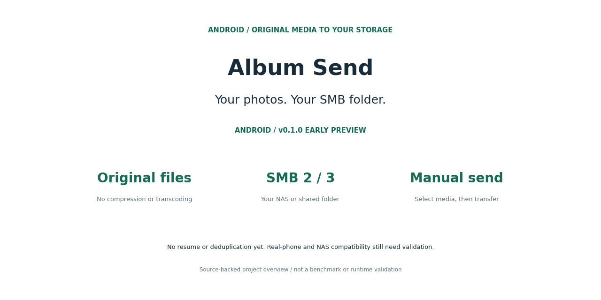
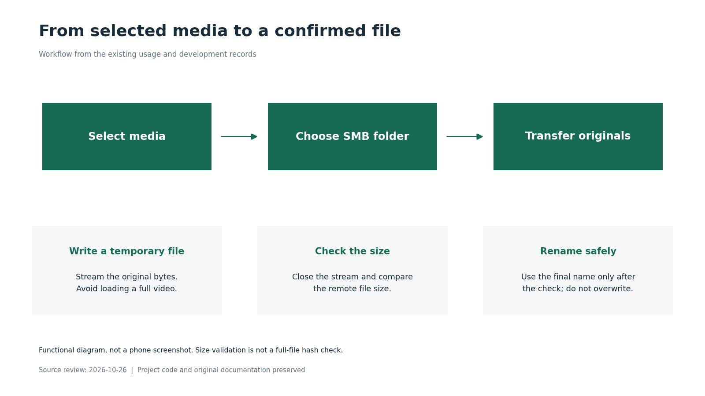

# Album Send · 相册快送



**Send your phone's photos and videos to a NAS or shared folder with one tap.**

Select your media, choose a folder on your local SMB server, and send the original files. No account registration, no image compression, and no third-party cloud service.

[Download the Android APK](https://github.com/wongzijie/album-send/releases/tag/v0.1.0) · [中文](README.md) · [Report an issue](https://github.com/wongzijie/album-send/issues/new/choose)

## Features

- Browse albums and filter photos or videos.
- Tap to select, or long-press and drag to select a range; scroll automatically at the edges.
- Discover local devices with TCP 445 open, or enter a host manually.
- Save SMB connections and preferred destinations on your phone.
- Navigate nested directories and send original files without transcoding.
- Rename duplicates without overwriting existing files.
- Track foreground-service transfer progress, cancel a transfer, or retry unfinished files.

## Get started

Requires Android 8.0+ and a reachable SMB share with write access.

1. Download `album-send-0.1.0-preview.apk` from [Releases](https://github.com/wongzijie/album-send/releases/tag/v0.1.0).
2. Install it and grant access to photos and videos.
3. Select media, tap **发送** (Send), choose a saved server or add a connection.
4. Browse to your destination and tap **发送到这里** (Send here).

The current app interface is in Chinese. The Android permission grant determines which media are visible. Server discovery scans at most the local IPv4 /24; enter an IP or hostname if discovery does not find your server.

## Preview status

v0.1.0 is an early preview signed with a debug key. Build, filename tests, and local SMB integration tests have passed. Real-device gestures, background behavior, and vendor-specific NAS compatibility still need testing.

This version performs manual transfers. It does not provide automatic incremental backup, duplicate detection, resumable uploads, or recovery after process termination. Sending the same file again creates a numbered copy. A forced process termination can leave a `.part` file. Transfers validate file size, not a whole-file hash.

Credentials are stored locally using Android Keystore-backed AES-GCM and excluded from application backups. Original media are retained on the phone. There is no cloud account, advertising, or analytics SDK.

## Development

Java 17, Gradle 9.2.1, AGP 9.0.1, compile SDK 36, target SDK 35, min SDK 26.

```sh
./gradlew :app:assembleDebug :app:testDebugUnitTest :app:lintDebug
```

See [development notes](docs/DEVELOPMENT.md), [roadmap](docs/ROADMAP.md), and [contribution guide](CONTRIBUTING.md). Please do not include credentials or private media in public issues.

The application code is MIT-licensed. Third-party libraries retain their own licenses; see [notices](THIRD_PARTY_NOTICES.md).

## Visual guide



[Image gallery and evidence](docs/assets/showcase/README.md). This documentation update does not revalidate the application runtime.
